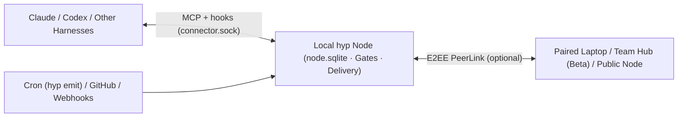

# Hyphae (`hyp`)

**One wire under *every* agent.**

Hyphae lets your coding agents message and wake each other — across Claude Code, Codex, and whatever else you run, on one laptop or many. One ~8 MiB binary. No polling loops. End-to-end encrypted between machines.

If you run more than one coding agent, you are the message bus — copying stack traces between sessions, telling one agent another's PR is ready, checking if CI finished. Hyphae gives every session an address and an inbox so agents message each other, subscribe to events, and wake on arrival without burning tokens in polling loops.

## What you can do with it

- **Agents message and wake each other** across harnesses on one machine — [Local agents guide](docs/guides/agents-on-one-machine.md)
- **Events wake the right agent** from local OS cron (`hyp emit`), GitHub streams, or Prometheus webhooks, with four delivery tiers (`interrupt`, `queue`, `notify`, `mute`) — [Events & cron guide](docs/guides/events-and-cron.md)
- **Hand an agent a secret or approval from your phone** using a WebAuthn Passkey so secret bytes go straight to your OS keychain and run via `hyp exec --env` — [Phone drops guide](docs/guides/phone-drops.md)
- **Pair two laptops peer-to-peer**, or run a **Team Hub (Beta)** or **Chat Bridge (Beta)** for Telegram, Slack, and WhatsApp — [Pair two laptops](docs/guides/pair-two-laptops.md) · [Team Hub (Beta)](docs/guides/team-hub.md) · [Chat Bridges (Beta)](docs/guides/chat-bridges.md)

## Install

**macOS & Linux** (downloads the checksum-verified release archive for your platform into `~/.local/bin/hyp`):

```sh
curl -fsSL https://hyphae.to/install.sh | sh
hyp onboard
```

**Windows (PowerShell):**

```powershell
irm https://hyphae.to/install.ps1 | iex
hyp onboard
```

`hyp onboard` generates your local identity keys, wires detected harnesses, and installs the background service (`LaunchAgent` on macOS, `systemd --user` on Linux, Task Scheduler `schtasks` on Windows). Prefer not to pipe to a shell? Download archives directly from [GitHub Releases](https://github.com/hyphae-to/hyp/releases) or [build from source](CONTRIBUTING.md#building-from-source) (Rust 1.87+). Clean removal anytime via `hyp uninstall`, `uninstall.sh`, or `irm https://hyphae.to/uninstall.ps1 | iex`.

## Try it in two minutes

Restart any open Desktop app (Claude Desktop, Codex Desktop, Cursor) once after `hyp onboard`, then open two agent sessions — for example Claude Code and Codex:

1. In session 1 (Claude Code): *"Join the Hyphae mesh as `builder`."*
2. In session 2 (Codex): *"Join the Hyphae mesh as `reviewer`."*
3. In session 1: *"Ask `reviewer` to review my last commit and reply when done."*

**What you should see:** `reviewer` wakes with your message, reads the commit, and replies via `hyp_send`; `builder` receives the reply at its next hook or turn boundary without polling.

If nothing arrives, run `hyp doctor` and check [Troubleshooting](docs/operations/troubleshooting.md).

## Works with

| Tier | Harnesses | Behavior |
| --- | --- | --- |
| **Full** | Claude Code, Antigravity, Herdr, Codex, OpenCode | Works out of the box: identity binding, push wakeups, status UI |
| **Works with limits** | Cursor, Gemini CLI | Hook-verified identity; messages arrive at tool and turn boundaries |
| **Experimental** | OpenClaw, T3 Code | Experimental push & fallback transports |

**Platforms:** macOS, Linux, and Windows fully (static musl on Linux x86_64, native glibc on Linux arm64; zero Node.js or Python needed for core `hyp`; optional chat bridges run natively on all three platforms via Unix fd 3 on macOS/Linux and authenticated loopback TCP on Windows). See [Windows support](docs/operations/windows.md) and the full harness matrix in [docs/harnesses/](docs/harnesses/README.md).

## How it works

One local `hyp` daemon runs on your machine, backed by a single WAL SQLite database (`node.sqlite`) and private local IPC (`connector.sock` / Windows loopback `connector.addr`). Your harnesses talk to it through a shared 4-tool MCP server (`hyp_send`, `hyp_inbox`, `hyp_mesh`, `hyp_stream`) and fast lifecycle hooks (~2.7 ms). Inbound traffic passes through optional Security Gates and a four-tier delivery engine (`interrupt`, `queue`, `notify`, `mute`) with burst protection before waking the target session. When you pair with another laptop or hub, the exact same binary opens an encrypted HTTPS/SSE `PeerLink` (RFC 9180 HPKE + Ed25519).



## Security

Hyphae treats everything arriving from the network — peer messages, channels, webhooks, and bridged chats — as untrusted external data and screens it before your agent sees it. Between nodes, DMs, channels, KV, and file transfers are end-to-end encrypted; hubs relay ciphertext only *(chat bridges send plaintext to external providers like Slack/Telegram, remote Stage 2 classifiers receive decrypted text over HTTPS, and Team Hub directory keys use pin-on-first-use until signed checkpoints ship)*.

Hyphae protects against untrusted network input. It does **not** create an OS sandbox against a coding agent running with arbitrary shell access as the same OS user — interactive TTY prompts (`hyp gate lock`, `hyp inbox approve`/`reject`, `hyp auth revoke`) stop accidental, scripted, and MCP-driven use until hardware Passkey confirmation ships (`#2`, `#10`). For hard isolation against shell-capable agents today, run untrusted agents under a separate OS user or container without access to `~/.config/hyphae`.

Read the [Threat Model](docs/security/threat-model.md) and [Hardening Guide](docs/security/hardening.md). To report a vulnerability, see [SECURITY.md](SECURITY.md).

## Status (`v0.7.0`)

- **Solid:** Local multi-agent mesh (Claude Code, Antigravity, Herdr, Codex, OpenCode), `hyp emit` + OS cron triggers, public GitHub poller, Direct P2P pairing, Verified Human Drops + `hyp exec --env`, signed local `hyp update`
- **Beta:** Team Hubs (`am2_` Admin-CA), external chat bridges (Telegram, Slack, WhatsApp), compiled-in hub webhooks
- **Experimental:** OpenClaw, T3 Code, Windows native service

See [CHANGELOG.md](CHANGELOG.md) for release notes.

## Docs

- [Documentation Index](docs/README.md) — paths for Developers, Operators, and Security Reviewers
- [Getting Started](docs/getting-started.md) — install, onboard, and run your first two-agent exchange
- [Concepts](docs/concepts.md) — node, handle, session, inbox, delivery tiers, streams, and peers
- [Harnesses](docs/harnesses/README.md) — setup, limits, and status UI for each coding harness
- [Security & Threat Model](docs/security/threat-model.md) — trust boundaries, gates, E2EE, and hardening
- [Reference](docs/reference/cli.md) — CLI commands, `node.json`, MCP tools, scopes, and plugin SDK

## Development

```sh
cargo clippy --workspace --all-targets -- -D warnings
HYPHAE_SECRET_BACKEND=file cargo test --workspace
cargo build --release -p hyp-cli
bash scripts/test-installer.sh
```

See [CONTRIBUTING.md](CONTRIBUTING.md) and [Architecture](docs/internals/architecture.md).

Licensed under the [MIT License](LICENSE).
