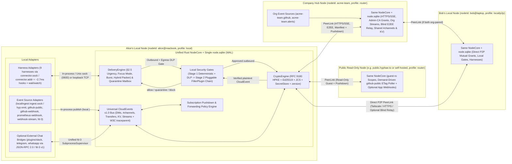
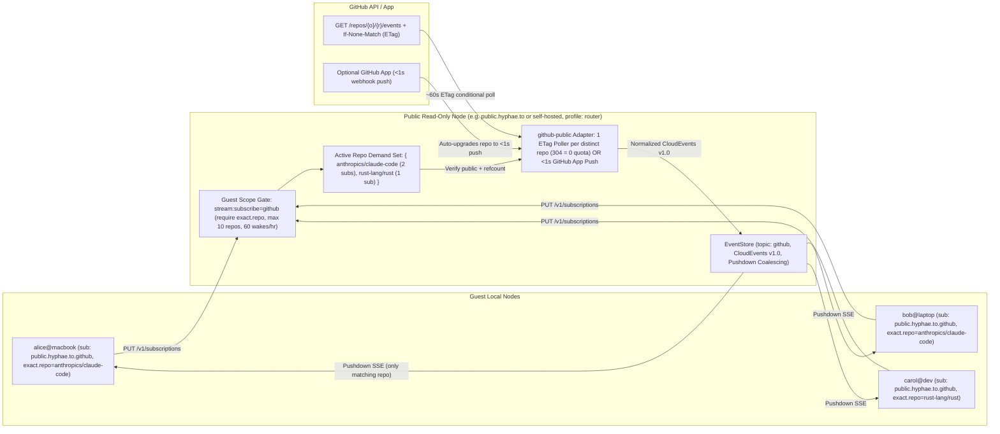
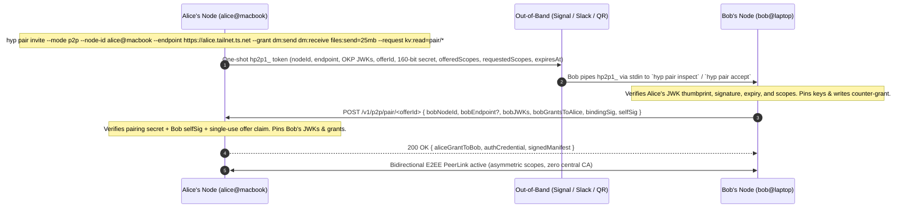
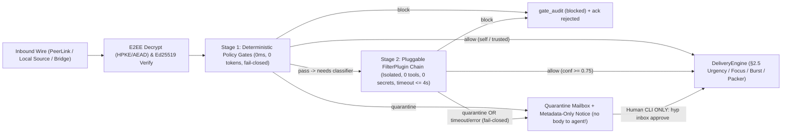
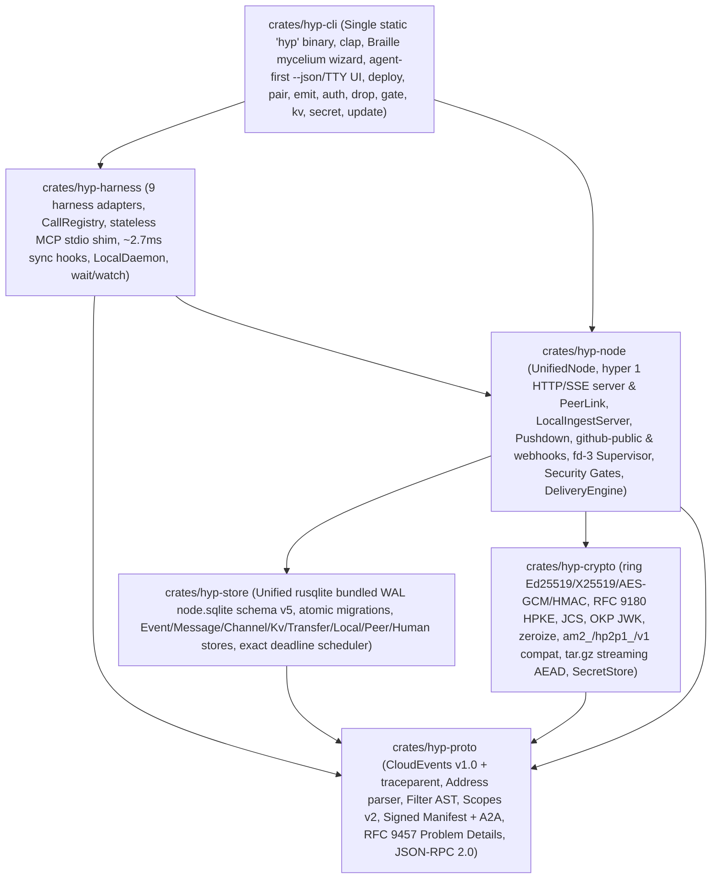

# Hyphae v2 Architecture: Unified Rust Node, Standards-First Wire Layer, P2P Federation, Capability Negotiation, Permissioned Pairing & Local Security Gates

> **Design North Star:** Collapse the legacy asymmetric *Connector vs. Router* split into **one composable `Node` primitive** implemented as a **single static Rust binary (`hyp`, ~6 MiB compressed download)** speaking **open, battle-tested standards** (CloudEvents v1.0, RFC 9180 HPKE, RFC 8785 JCS, RFC 9457 Problem Details, POSIX `tar+gzip`, JSON-RPC 2.0) — delivering **~2.7 ms hook cold starts**, **~2.8 MB idle MCP RSS**, **memory-zeroized E2EE**, **direct laptop-to-laptop P2P**, **demand-driven public streams (such as `public.hyphae.to` or self-hosted public nodes)**, **pluggable local Security Gates**, and **100% wire & fd-3 plugin compatibility** across all 9 agent harnesses.

---

## Executive Overview: Unified `Node` Data Flow

---

## 1. One Generic `Node` Primitive (Unifying Router + Connector + Plugins + Streams)

### 1.1 Why v2 Eliminated the Legacy Connector/Router Split

Hyphae v1 ran separate *Connector* and *Router* processes with two SQLite databases, loopback self-HTTP between an embedded router and local connector, a hardcoded `"primary"` router hegemony, duplicate fd-3 subprocess supervisors, and asymmetric identities (connectors held keypairs while routers did not).

**v2 Resolution:** Eliminate the conceptual divide between a "Connector" and a "Router". Hyphae v2 has **one primitive: `Node`** (`crates/hyp-node/src/engine/node.rs`).

### 1.2 The Unified `Node` Model

Every `Node` bundles four cleanly separated layers:

1. **Cryptographic Identity (`NodeIdentity` in `crates/hyp-crypto`):**
   - Canonical `nodeId` matching `/^[a-z0-9][a-z0-9@._-]{0,63}$/` (`local` is reserved to mean "this node").
   - One persistent Ed25519 signing keypair + one persistent X25519 encryption keypair stored in `SecretStore` (macOS Keychain via `/usr/bin/security`, Linux Secret Service via `secret-tool`, or `0600` headless file fallback: `node-sign-<hash12>`, `node-enc-<hash12>`, transparently reading legacy `id-sign-<hash12>` / `id-enc-<hash12>` so upgraded machines keep their fingerprints).
   - Published as standard **RFC 7517 / RFC 8037 OKP JWKs** (`Ed25519` + `X25519`) with **RFC 7638 SHA-256 JWK Thumbprints** (`kid`).
   - Optional offline Org Root Admin-CA keypair (`admin-ca-<hash12>`) used by admins to issue `am2_` grants without ever placing the Admin private key on the Team Hub host.

2. **Single Unified SQLite WAL Store (`node.sqlite` in `crates/hyp-store`, schema v5):**
   - One WAL-mode SQLite database (`rusqlite` bundled SQLite, `PRAGMA journal_mode = WAL; PRAGMA busy_timeout = 5000; PRAGMA foreign_keys = ON;`), driven by an exact deadline scheduler (`next_deadline_ms()`) with zero polling loops.
   - Logical table groups migrated atomically in one `BEGIN IMMEDIATE` transaction (through `CURRENT_SCHEMA_VERSION = 5`):
     - **Universal Event & Messaging Bus (`events.rs`, `messages.rs`, `transfers.rs`):** `handles`, `events`, `subscriptions`, `batches`, `batch_events`, `upstream_pushdowns`, `channel_members`, `channel_epochs`, `transfers`
     - **Shared State (`kv.rs`):** `kv_entries`, `kv_epochs`
     - **Federation & Trust (`peers.rs`):** `peers`, `grants`, `revocations`, `peer_keys`, `directory_checkpoints`
     - **Local Runtime & Security (`local.rs`):** `metadata`, `sessions`, `mailbox` (with `gate_state`), `deliveries`, `muted_sources`, `plugin_targets`, `bridge_links`, `gate_audit` (protected by SQLite immutability triggers)
     - **Schema v4–v5 — Verified Human Authority (`human.rs`, `0005_human_enc_jwk.sql`):** `human_authorities` (enrolled Tier 1 Ed25519 phone Passkey+PRF & CLI keys, revocation epoch, and additive schema v5 `enc_jwk_json` storing the companion Passkey-PRF X25519 public key for HPKE-encrypted directive draft prefills `encDraft`, bound into `human_authorities_digest` / `gate_policy_sig`), `human_nonces` (single-use `claim_id` replay protection pruned by deadline scheduler), and `human_node_certs` (`NodeCertV1` anti-phishing node bindings)

3. **Uniform Composable Adapter Trait (`NodeAdapter` in `crates/hyp-node/src/adapters/trait_def.rs`):**
   Every external integration attaches to `UnifiedNode` through one narrow trait (`AdapterKind::{Harness, Source, Bridge, PeerLink}`):

| Adapter Class | Concrete Implementations | Architectural Benefit |
| --- | --- | --- |
| **(a) Harness Adapters** (`crates/hyp-harness`, `crates/hyp-cli/src/skill_render.rs`) | Unix socket server (`connector.sock`, `0600`) / Windows loopback TCP (`connector.addr`), `CallRegistry` hooks (`PreToolUse`/`PostToolUse`/`PreInvocation`/`Stop`), Claude native channel, `hyp wait`/`hyp watch`, Codex rollout/queue, T3 Code (`statev2.sqlite`), Herdr (`hc`), Cursor, OpenCode, Gemini CLI, OpenClaw; orchestrator-aware tailored `hyphae/SKILL.md` rendering (`hyp setup --refresh-skills` / `--force-skills`) + dynamic backend-aware MCP `initialize.instructions`. | Calls `UnifiedNode` in-process with zero loopback HTTP overhead, ~2.7 ms hook latency, and zero duplicate messaging/scheduling instructions on OpenClaw or Antigravity. |
| **(b) Compiled-In Event Source Adapters & Local Ingest** (`crates/hyp-node/src/adapters/`, `engine/local_ingest.rs`) | Pure-Rust in-process `github-public`, `github-webhook`, `prometheus-webhook`, `webhook-stream`, plus the default-enabled socket-only Local Ingest Route (`localIngest` on `0600` `ingest.sock` / Windows `ingest.addr`, `hyp emit` -> `local.schedule` / `local.<topic>`) calling `host.publish_event()` directly + demand-driven `on_subscriptions_changed()` / `validate_subscription()` hooks. | Zero Node/Python runtime and zero extra MCP tools needed for core streams or OS-scheduled triggers (`systemd-run`, `crontab`, `launchd`, `schtasks`); no extra loopback webhook hop. |
| **(c) Optional External Bridges & Custom Sources** (`plugins/` + `SubprocessSupervisor`) | Optional external scripts (`plugins/slack`, `plugins/telegram`, `plugins/whatsapp`, `plugins/webhook`, `plugins/prometheus`, or custom binaries) supervised over duplex Unix fd 3 (JSON-RPC 2.0 v2 + auto-detected legacy fd-3 v1). | One bounded 64 KiB supervisor with scrubbed `ALLOWED_PARENT_ENV`, `bridge_links`, live `handoff`, and outbound `hyp_send({ to: "<plugin>:<target>" })`. |
| **(d) Peer Node Links** (`PeerLink` in `crates/hyp-node/src/engine/peer_link.rs`) | Bidirectional `hyper 1` HTTPS + WHATWG SSE link to any remote Hyphae `Node`. | Eliminates `"primary"` hegemony: Team Hubs, public read-only nodes, and Direct P2P laptops are all symmetric `PeerLink`s. |

### 1.3 Specializations Are Pure Configuration Profiles

| Profile | Local Harness IPC | HTTP/SSE Peer Listener | Local Bridges / Sources | Outbound `PeerLink`s | Default Forwarding | Typical Deployment |
| --- | --- | --- | --- | --- | --- | --- |
| **`local`** *(default)* | Enabled | Off by default (enabled via `--bind` or `listen.bind`) | Optional | 0..N (`acme-team`, public nodes, `bob@laptop`) | `deny` | Developer laptop / workstation / SSH devbox |
| **`router`** *(Team / Public Hub)* | Off by default (`--no-local-socket` for containers) | Enabled (loopback behind Tailscale Serve / Caddy / Cloudflare / Fly Proxy) | Org or demand-driven sources (`github`, `github-public`, `alerts`) | Optional (explicitly federated hubs) | `deny` or `allowlist` | Always-on VM / container / Team Hub / Public Node |
| **`p2p`** *(Direct Laptop-to-Laptop)* | Enabled | Enabled (Tailscale MagicDNS HTTPS, direct HTTPS, or blind relay) | Optional | Direct mutual links to collaborator nodes | `deny` | Alice <-> Bob with **zero** central server |

> **Zero architectural migration:** A solo user running `hyp onboard` starts one `Node` (`profile: "local"`, zero open ports, one `node.sqlite`). Switching to `p2p` or generating a deployment kit with `hyp deploy init` runs the exact same binary and storage schema.

---

## 2. Scoped Event & Subscription Propagation (`local.<source>` vs. `<remote-node-id>.<source>`)

### 2.1 Unified Addressing & Namespace Grammar

Both `NodeId` (`/^[a-z0-9][a-z0-9@._-]{0,63}$/`) and `Topic` (`/^[a-z0-9][a-z0-9._-]{0,63}$/`) permit `.`. Naive splitting on `.` breaks on `alice.smith@macbook.github` or `public.hyphae.to.github`.

1. **On the wire and in `node.sqlite`**, node scope and resource name are **always separate structured fields** (`{ origin_node, topic }`, `{ host_node, channel }`, `{ host_node, namespace, key }`).
2. **At the human/agent UX surface (MCP + CLI)**, qualified strings use deterministic longest-prefix matching against paired peer IDs:

| Entity | Canonical Qualified Form | Shorthand | Deterministic Resolution Rule |
| --- | --- | --- | --- |
| **Local event topic** | `local.<topic>` (e.g. `local.schedule`, `local.github`, `local.kv`) | `<topic>` (when targeting local) | Exact prefix `local.` always targets this Node's local `EventStore` (including default `localIngest` routes on `local.schedule` / `local.local`). |
| **Remote event topic** | `<node-id>.<topic>` (e.g. `acme-team.github`, `public.hyphae.to.github`) | `<topic>` + explicit router | Match longest known paired `<peer-id>` followed by `.` (so `public.hyphae.to.github` resolves `peer = "public.hyphae.to"`, `topic = "github"`). |
| **Direct agent peer** | `<node-id>/<handle>` (e.g. `alice@macbook/claude`, `local/codex`) | `<handle>` -> `local/<handle>` | `local/<h>` expands to `<self.nodeId>/<h>`. Remote `<nodeId>/<h>` resolves via direct `PeerLink`, else hub `PeerLink` advertising `<nodeId>`. |
| **Room / `#channel`** | `<node-id>/#channel` (e.g. `acme-team/#incidents`, `local/#scratch`) | `#channel` | Bare `#channel` targets the default active hub peer, or `local` if standalone. |
| **Chat bridge sink** | `<bridge>:<target>` (e.g. `slack:pm`) | `<bridge>:<target>` | Local-only by default; remote bridge posting requires explicit `bridge:post=<bridge>:<target>` scope (never included in `*`). |
| **Shared KV** | Structured `{ node, namespace, key }` (`hyp_kv`) / `--node <id> --ns <ns> --key <key>` (`hyp kv`) | Defaults `node` to active peer or `"local"` | `hyp kv get --node acme-team --ns deploys --key checkout` or `hyp_kv({ action: "get", node: "acme-team", namespace: "deploys", key: "checkout" })`. |

### 2.2 Subscription Pushdown Engine (Filter Compilation & End-to-End Flow)

When local agents subscribe to a remote node's topic, **non-matching events never cross the wire**:

1. **Local Registration:** Each agent's subscription persists in `node.sqlite` (`origin_node`, `topic`, `filters`, `coalesce_seconds`, `mode`).
2. **Pushdown Compilation:** Wraps each local subscription's AND-list as a CloudEvents Subscriptions API v1.0 `Filter`, deduplicates via RFC 8785 JCS, merges into `[{ any: [...] }]`, and deterministically **shards** into multiple upstream pushdown IDs (`pd:<sha256(topic)>:0..7`) if the merged AST exceeds `MAX_FILTERS_BYTES` (4 KiB) or `MAX_FILTER_DEPTH` (8). Upstream `coalesceSeconds = min(localSubs.coalesceSeconds)`.
3. **Upstream Sync & Reachability Diagnostics:** Sends `PUT /v1/subscriptions` upstream. The remote node runs both static `diagnose_subscription()` rules and dynamic adapter checks (such as `github-public` visibility verification), returning actionable diagnostics (`unmonitored_repo`, `invalid_github_subject_filter`, `repo_not_found_or_private`) straight back to the subscribing agent (`strict: true` fails closed).
4. **Runtime Forwarding & Crash-Safe Ingest:** Non-matching events drop upstream (0 wire bytes). Matching batches stream over WHATWG SSE `/v1/inbox`, commit atomically into local `node.sqlite`, ack upstream only after `COMMIT`, and flow through **Local Security Gates (§5)** and **`DeliveryEngine` (§2.5)**.

### 2.3 Multi-Hop / P2P Forwarding Rules, Loop Prevention & Backpressure

**Hard security invariant:** **NO Node is ever an implicit open relay.**

- **Default policy:** `forwarding: { mode: "deny", rules: [] }`. Only `"deny"` or explicit `"allowlist"` is accepted (`hyp deploy check` fails closed on anything else).
- **Cycle & Loop Detection:** Cross-node CloudEvents carry `hyphaeorigin`, `hyphaevia` (ordered `nodeId`s traversed, ≤ 256 chars), `hyphaehops` (default max `2`, hard protocol cap `4`), and W3C `traceparent`. Loops or hop overflows fail closed (`400` RFC 9457 `routing_loop` / `hop_limit_exceeded`).
- **Backpressure & Offline Queueing:** Upstream buffers matching batches durably in `node.sqlite` while laptops sleep. If local mailbox or Stage 2 gates saturate, the receiver returns `hold("local_inbox_full" | "gate_busy")` and honors RFC 9110 `Retry-After` on HTTP 429/503.

---

### 2.4 Case Study: Read-Only Public Nodes (e.g. `public.hyphae.to` or Self-Hosted) & Demand-Driven `github-public`

The Unified Node + Permissioned Pairing + Subscription Pushdown architecture enables turnkey read-only public GitHub stream nodes — such as the example hosted node `public.hyphae.to` or any self-hosted community/organization public node deployed via `hyp deploy init public-node` (see [docs/public-node.md](public-node.md)):

1. **Read-Only Guest Pairing (`hyp pair join https://<public-node>`):** Self-service `POST /v1/guest/pair` requires a fresh Ed25519 possession proof (`409 peer_key_mismatch` on hijack attempts) and grants strictly `stream:subscribe=github[require=exact.repo;maxValues=10;maxBatchesPerHour=60]` — zero DM, `#channel`, file, or KV write privileges.
2. **Subscribe-Time Visibility Lint:** `GitHubPublicAdapter::validate_subscription()` verifies via `GET /repos/{owner}/{repo}` that each requested `exact.repo` exists and is public; private/missing repos fail closed with HTTP `422 subscription_rejected`.
3. **Deduplicated ETag Poller Pool:** Exactly **1** poller runs per distinct `owner/repo` regardless of subscriber count. `If-None-Match` `304 Not Modified` responses cost `0` GitHub quota; idle repos back off (`1x -> 2x -> 5x`) and tear down cleanly after the 5-minute grace window once subscriber refcount reaches `0`.
4. **Optional `<1s` GitHub App Push (`POST /v1/webhooks/github-app`):** When `appWebhookSecret` is configured via `SecretStore`, HMAC-verified webhooks publish onto the exact same `github` CloudEvents topic and deduplicate cleanly with ETag pollers.
5. **100% Portable to Local Nodes:** Because `github-public` is compiled directly into `hyp`, any user can enable it locally in `node.json` (with `{ "secret": "github-public-token" }` and optional `"allowPrivateWithToken": true`) with zero external service dependency.

---

### 2.5 Universal Delivery Policy (`interrupt` / `queue` / `notify` / `mute`), Burst Protection & Filtered Inbox Pagination

Implemented in `crates/hyp-node/src/delivery/` (`policy.rs`, `burst.rs`, `packer.rs`, `inbox_query.rs`). Every inbound source entering a Local Node — **DMs**, **`#channels` / `#announcements`**, **event stream subscriptions**, and **chat bridges** — shares one unified delivery model:

| Urgency Tier | Delivery Timing | Typical Use Case |
| --- | --- | --- |
| **`interrupt`** | Wakes an active **or** idle agent thread immediately (`hc interrupt`, `codex queue`, Claude native channel, T3 RPC, `hyp wait`). | High-priority peers (`@oncall`, `@ops`), `#incidents`, `severity=critical` alerts. |
| **`queue`** *(default)* | Held cleanly until the agent finishes its current turn / goes idle (`PostToolUse`/`Stop` boundary), coalescing simultaneous arrivals into one batch. | Normal peer DMs (`@alice`), PR reviews, non-emergency `#channels`. |
| **`notify`** *(digest queued for next turn)* | Holds full payloads durably in the local inbox (`state = 'unread'`) **and queues a slim 1-line digest notification onto the agent's next turn / idle boundary** — zero polling, nothing missed; full bodies read on demand via filtered, cursor-paginated `hyp_inbox`. | Focus Mode (`* -> notify`), low-priority peers/bots, high-volume streams, `#deploys`, public feeds. |
| **`mute`** *(silent archive, not unread)* | Accumulates durably in the local inbox with **`state = 'muted'`** (**never** triggers a wake or standalone digest, and excluded from default `hyp_inbox()`). Whenever *another* delivery fires, its footer piggybacks `· N muted`, and muted items stay inspectable on demand via `hyp_inbox({ state: "muted", filter, cursor })`. | Noisy rooms or temporarily muted peers you may catch up on later. |

1. **Per-Source Overrides & Focus Mode (`* -> notify`):**
   - `hyp_inbox({ mode: "queue" | "notify", rules: [{ target, delivery: "interrupt" | "queue" | "notify" | "mute" }] })` configures Focus Mode and ordered specificity-ranked overrides (`@handle`, `<node>/<handle>`, `<node>/*`, `#channel`, `<node>.<topic>`, `topic:<topic>`, `<plugin>:<target>`, `*`), with optional VIP `interrupt` exceptions during Focus Mode.
2. **Adaptive Burst Protection ("Noisy Mode"):**
   - Default rolling threshold: `10` arrivals inside a `60s` window per source engages **Noisy Mode** for `300s` (`min_delivery_interval: 30s`), stepping `interrupt`/`queue` floods automatically down to `notify` digests (`mute` stays `mute`).
3. **Token-Budget-Aware Hybrid Batch Packing:**
   - Defaults: `max_batch_tokens = 1200` (~4800 chars), `max_inline_items = 6`, `max_single_item_share = 0.60`.
   - Sorts pending unread items by priority band (**`interrupt` -> `queue` DMs/`#announcements` -> `queue` `#channels`/streams -> `notify`/burst-demoted**), packs highest-priority items inline in full, truncates single giant payloads with a `hyp_inbox(ids:["..."])` pointer, and spills remaining items into a compact 1-line digest footer grouped by source (plus `· N muted` whenever muted items exist).
4. **Unified Filtered & Cursor-Paginated Inbox (`hyp_inbox`):**
   - Queries `state: "unread" | "muted" | "delivered"` (or `"all"`) with structured `filter: { from?, node?, topic?, channel?, kind?, ceFilters? }`, `limit` (`1..=50`, default `20`), opaque base64url `cursor`, `summary`, `ack`, and `ids`. Strictly refuses `quarantined` and `rejected` states fail-closed.

---

## 3. Capability Advertisement, Protocol Negotiation & Version Skew UX

### 3.1 Signed Node Capability Manifest (`GET /v1/manifest`)

Every v2 `Node` serves a signed **Node Capability Manifest** (`crates/hyp-proto/src/manifest.rs`) at `GET /v1/manifest` (with RFC 9110 `ETag` / `If-None-Match`), verifies it on `hyp pair join` and `hyp deploy check`, and emits `to.hyphae.node.manifest` CloudEvents on capability/scope updates.

- **Envelope**: `SignedNodeManifest { payload, sig }` where `payload` is strict RFC 8785 JCS canonical JSON of `NodeManifestPayload` (`v: 1`, `nodeId`, `profile`, `hyphaeVersion`, `protocolRange`, `manifestVersion`, `issuedAt`, `expiresAt`, `audience`, `identity: { signingJwk, encryptionJwk, kid, adminJwk? }`, `capabilities`, `policy`, `advertised`, `escalation?`) and `sig` is RFC 8032 Ed25519 over `"hyphae/v2/manifest\n" || payload`.
- **Anti-Recon Invariant:** Unauthenticated requests return `audience: "public"` with **empty `advertised` arrays and no `escalation` text**. Authenticated paired peers receive a manifest scoped strictly to their `ScopeSet`.

#### Canonical Versioned Capability Tokens

| Capability Token | Meaning |
| --- | --- |
| `manifest.v1` | Signed `GET /v1/manifest` (JWK + JCS + ETag) + SSE `to.hyphae.node.manifest` |
| `envelope.ce.v1` | Universal CloudEvents v1.0 envelope for DMs, `#channels`, KV, transfers + W3C `traceparent` |
| `dm.v1` / `dm.e2ee.v1` | Plaintext DMs / RFC 9180 HPKE E2EE DMs |
| `channel.v1` / `channel.e2ee.v1` | Plaintext `#channels` / Signed Epoch Room Key (HPKE-wrapped) E2EE `#channels` |
| `transfer.v1` / `transfer.stream.v2` | Buffered v1 / streaming POSIX `tar.gz` 64 KiB chunked AEAD multi-recipient transfers |
| `events.v1` / `sub.pushdown.v1` / `events.e2ee.v1` | CloudEvents pub/sub / aggregated pushdown + hop provenance / hybrid E2EE payloads |
| `kv.v1` / `kv.e2ee.v1` | Shared KV blackboard + `kv` CloudEvents stream / namespace-scoped E2EE KV |
| `pairing.admin-ca.v1` / `pairing.p2p-mutual.v1` / `pairing.guest.v1` | Org Admin-CA `am2_` / Direct mutual `hp2p1_` / Self-service guest pairing |
| `gate.policy.v1` | Local Security Gate pipeline metadata |
| `p2p.direct.v1` / `p2p.relay.v1` | Direct node-to-node peer links / optional blind relay |
| `keys.prekey.v1` / `directory.checkpoint.v1` | Rotating prekeys / signed anti-rollback directory checkpoints |
| `node.self-update.v1` | Signed remote fleet update orchestration (`hyp update --all`, requires `node:update` scope) |
| `human.auth.v1` (`HumanAuthV1`) | Tier 1 Ed25519 + companion X25519 (`enc_jwk_json`, schema v5) Verified Human Drops (`hdrop1_`, `hcert1_`, HPKE `human.draft.v1` `encDraft` directive prefills, `TrustTier::HumanVerified`, zero-knowledge `SecretStore` drops, and `hyphaesig` signed local ingest events) |
| `drop.relay.v1` (`DropRelayV1`) | RAM-only zeroized ciphertext Blind Drop Relay (`POST /v1/drops`, stateless `hdcap1_` caps, burn-after-read SSE catch-up) |

### 3.2 Capability Negotiation & Fail-Closed Skew Diagnostics

`hyp status` and `hyp doctor` (`crates/hyp-cli/src/status_doctor.rs`) render a **Peer Capabilities & Version Skew** table checking:
1. Protocol range intersection (`FAIL` on `protocol_incompatible`).
2. Anti-downgrade E2EE ratchet (`FAIL` on `capability_downgrade_detected` when previously observed `dm.e2ee.v1` or `channel.e2ee.v1` disappears).
3. Local `policy.requireE2ee` enforcement (`FAIL` if a non-`guest-ro` peer lacks `dm.e2ee.v1`).
4. Optional capability degradation (`WARN` on legacy v1 peers or missing `kv.e2ee.v1` / `transfer.stream.v2` / `sub.pushdown.v1`).

All HTTP error responses use **RFC 9457 Problem Details** (`application/problem+json` via `crates/hyp-proto/src/problem.rs`) carrying machine-actionable `error`, `detail`, and remediation hints.

---

## 4. Permissioned Pairing & Escalation Notes

### 4.1 v2 Scope Grammar (`crates/hyp-proto/src/scopes.rs`)

OAuth 2.0 (RFC 6749) space-delimited ASCII resource- and predicate-confined scopes, preserving v1 alias compatibility (`messages:send` -> `dm:send=*`, `events:subscribe` -> `stream:subscribe=*`) and failing closed on unknown tokens:

| Scope Pattern | Meaning & Enforcement Point |
| --- | --- |
| `dm:send` / `dm:send=<target1,target2>` | Send DMs to `*` or specific `<handle>` / `<node>/<handle>` allowlist. |
| `dm:receive` | Receive DMs from peers. |
| `channel:join=<#c1,#c2\|*>` / `channel:post=<#c1,#c2\|*>` | Join or post to listed `#channels` (supports read-only observers). |
| `stream:subscribe=<topic>[<constraints>]` | Subscribe to `<topic>` with server-enforced filter/rate constraints (e.g. `stream:subscribe=github[require=exact.repo;maxValues=10;maxBatchesPerHour=60]`). |
| `stream:publish=<topic>` | Publish CloudEvents into `<topic>`. |
| `files:send[=<maxBytes>]` / `files:receive[=<maxBytes>]` | Send/receive E2EE file transfers capped at `maxBytes` (e.g. `files:send=50mb`). |
| `kv:read=<ns/prefix*>` / `kv:write=<ns/prefix*>` | Read/watch or mutate KV entries matching namespace + prefix glob. |
| `bridge:post=<plugin:target>` | Post outbound to a node's chat bridge. **Never included in `*`; explicit opt-in only.** |
| `forward:via=<node-pattern>` | Permit transit forwarding through this node. **Never included in `*`; explicit opt-in only.** |
| `drop:create` | Allocate ephemeral RAM-only Blind Drop Relay slots (`POST /v1/drops`). Excluded from `guest-ro` unless explicitly granted. |

**Built-In Presets (`hyp pair guide`):** `guest-ro`, `guest`, `observer`, `member`, `full` (`*`, explicitly excluding `bridge:post` and `forward:via`).

### 4.2 Escalation Notes & Anti-Prompt-Injection Framing

Nodes may attach `escalation.default` and `escalation.byScope` hints to authenticated manifests and `403 not_granted` responses. Both ends cap escalation notes at `512` UTF-8 bytes, strip control characters, and wrap them as untrusted external data (`{ untrusted: true, provenance, text }`) so agents show hints verbatim to humans and never execute instructions inside.

### 4.3 Pairing Topologies (`hyp pair`)

1. **Org Admin-CA Pairing (`am2_`, Hub-and-Spoke):**
   - Admin private key stays strictly on the admin machine — never on the Team Hub host.
   - `hyp pair invite --mode team --node-id acme-team --endpoint https://mesh.acme.internal --peer alice@macbook --preset member` -> accepted over stdin via `hyp pair accept <<< "$TOKEN"` (or `hyp onboard --join - <<< "$TOKEN"`).
2. **Direct P2P Mutual Pairing (`hp2p1_`, Zero Central CA):**

- **Zero TOFU MITM window:** Alice's OKP JWKs travel inside the out-of-band `hp2p1_` token; Bob proves possession of both the 160-bit pairing secret and his own Ed25519 key.
- **NAT-friendly:** Only one peer needs a reachable HTTPS or Tailscale endpoint; the behind-NAT peer connects outbound and carries bidirectional traffic over one HTTPS+SSE link.

---

## 5. Local Security Gates (`crates/hyp-node/src/gates/`)

### 5.1 Architectural Placement & Trust Boundary

**Non-negotiable invariants:**
1. **Strictly post-decrypt (inbound) and pre-encrypt (outbound).**
2. **No MCP self-approval:** Approving/rejecting quarantined items (`hyp inbox approve`, `hyp inbox reject --mute`) and locking gate policy (`hyp gate lock`) are **strictly human local CLI operations** — there is zero MCP surface for quarantine approval.

### 5.2 Stage 1 (Deterministic) & Stage 2 (Pluggable `FilterPlugin` Chain)

- **Stage 1 (`stage1.rs`):** Identity/E2EE verification, trust-tier tagging (`self`, `human-verified`, `org`, `peer`, `guest`, `external-webhook`, `bridge`), mutes, CloudEvents Filter AST allow/denylists, per-sender token-bucket rate limits, payload size caps, inbound regex denylists, **outbound secret DLP scanner**, **streaming `tar.gz` attachment guard**, and automatic `guest`/`external-webhook` downgrade to `notify`/quarantine. Socket-only `localIngest` routes (`gate: true`) screen inbound local events here too: verified `hyphaesig` events (`ed25519:<kid>:<b64url>`) and Verified Human Directives receive `TrustTier::HumanVerified`, bypassing Stage 2 untrusted-peer filters while recording immutable `human_authority` / `local_ingest` rows in `gate_audit` (`requireSignature: true` fails closed on unsigned events).
- **Stage 2 (`stage2.rs`, `plugins.rs`):** Composable chain of 6 adapters (`anthropic`, `openai-compat`/Ollama, `google`, `lakera-guard`, `http-classifier`, JSON-RPC 2.0 `subprocess`), all isolated with zero tools/workspace/secrets, compiled-in immutable core rubric + additive `policy_notes`, randomized 64-bit untrusted payload fences, `max_input_chars = 16,384`, `max_output_tokens = 160`, `timeout_ms = 4,000`, `max_concurrent = 4` (`Hold("gate_busy")`), `min_allow_confidence = 0.75`, and fail-closed `on_error: quarantine | block`.
- **Tamper-Evident Policy Signature (`gate_policy_sig`):** Domain-separated HMAC-SHA256 over canonical JCS of `gate` config (binding `human_authorities_digest` — including schema v5 `enc_jwk_json` — against `node.sqlite`'s `human_authorities`) keyed from `SecretStore` (`gate-policy-hmac-key`), locked via `hyp gate init --adapter ... --lock` or `hyp gate lock`.
- **Audit & Human Review CLI:**
  - `hyp gate log [--decision all|quarantined|blocked|allowed|error] [--limit 50] [--session <id>] [--json]`
  - `hyp gate review [--session <id>] [--limit 50] [--json]`
  - `hyp inbox approve <receipt> [--reviewer <name>] [--json]`
  - `hyp inbox reject <receipt> [--mute] [--reason <text>] [--json]`

---

## 6. Standards-First Wire & Data Format Layer

| Primitive | Open Standard / RFC | Workspace Implementation | Why It Wins |
| --- | --- | --- | --- |
| **Universal Bus Envelope** | **CloudEvents v1.0** + **W3C `traceparent`** + **CE Subscriptions API v1.0** | `crates/hyp-proto` (`serde`, `serde_json`) | One filter engine, coalescer, loop guard, dedup store, and Security Gate across DMs, `#channels`, KV, transfers, streams, and bridges. |
| **Public-Key Encryption** | **RFC 9180 HPKE Base Mode** (`DHKEM(X25519, HKDF-SHA256)` + `HKDF-SHA256` + `AES-256-GCM`) | `crates/hyp-crypto` (`ring`, `zeroize`) | Formally audited fixed suites with native AAD/info binding and zero JWE algorithm-confusion footguns. |
| **Canonical Signing & Key Identity** | **RFC 8785 JCS** + **RFC 8032 Ed25519** + **RFC 7517/8037 OKP JWK** + **RFC 7638 Thumbprint** | `crates/hyp-proto`, `crates/hyp-crypto` (`ring`, `sha2`) | Deterministic cross-language signing, standard JWK `kid` thumbprints, domain separation (`"hyphae/v2/<kind>\n"`), no `alg:none` pitfalls. |
| **File Transfer Container** | **POSIX `tar` (USTAR/PAX)** + **RFC 1952 `gzip`** + **OCI `sha256:<hex>`** + 64 KiB chunked AEAD | `crates/hyp-crypto/src/transfer.rs` (`flate2`, `ring`, `sha2`) | Single-pass `O(64 KiB)` constant-RAM streaming with fail-closed symlink/traversal/256 MiB decompression-bomb enforcement. |
| **HTTP Errors, Caching & Transport** | **RFC 9457 Problem Details**, **RFC 9110** (`ETag`/`If-None-Match`/`If-Match`/`Retry-After`), **WHATWG SSE**, **SemVer 2.0** | `crates/hyp-node` (`hyper 1`, `hyper-util`, `hyper-rustls`, `rustls`, `http`, `tower`, `semver`) | Machine-actionable errors, zero-quota `304` polling, atomic KV CAS headers, zero proxy friction over Tailscale/Caddy/Cloudflare/Fly. |
| **Plugin Subprocess IPC** | **JSON-RPC 2.0 over NDJSON** (duplex Unix fd 3, auto-detected legacy v1 fallback) | `crates/hyp-proto/src/rpc.rs`, `crates/hyp-node/src/adapters/supervisor.rs` | Matches MCP & LSP framing while preserving compatibility with `plugins/sdk/client.{mjs,py}` and all scripts in `plugins/`. |
| **Permissions & Discovery** | **RFC 6749**-style scope tokens + Signed Manifest (+ opt-in **A2A** `/.well-known/agent.json` projection) | `crates/hyp-proto/src/{scopes,manifest}.rs`, `crates/hyp-node/src/engine/server.rs` | Maps cleanly to enterprise OIDC/Okta policies without forcing cloud auth onto local P2P nodes. |

---

## 7. Shared KV, Workspace Architecture & Differential Testing

### 7.1 Shared KV / Blackboard (`kv.v1` + `kv.e2ee.v1`)

`KvStore` (`crates/hyp-store/src/kv.rs`) is built directly into `node.sqlite` (`kv_entries`, `kv_epochs`):
- **Three Namespace Write Models**: `owner` (single designated writer, default), `shared` (optimistic CAS via RFC 9110 `If-Match` / `expectedVersion`, returning `409 version_conflict` on race), and `allowlist` (explicit writer allowlist).
- **Zero-Polling Watches**: Every KV mutation emits `to.hyphae.kv.set` / `to.hyphae.kv.deleted` CloudEvents onto `<node>.kv` so agents watch key prefixes via `hyp_stream` with pushdown filtering.
- **E2EE-Native (`kv.e2ee.v1`)**: Uses epoch-wrapped room keys + `AES-256-GCM` AAD over `(hostNodeId, ns, key, version, epoch, writer)` — works identically across Direct P2P and blind Team Hubs.
- **Interfaces**: Conditional MCP tool `hyp_kv` (`action: get | set | delete | list`) and direct CLI `hyp kv [get | set | delete | list]`.

### 7.2 Pure-Rust 6-Crate Workspace Layout

| Metric | Pure-Rust Static Binary (`hyp`) |
| --- | --- |
| **Compressed release download** | ~6 MiB static binary (macOS, Linux, Windows; zero Node.js/Python required) |
| **Hook cold start (`hyp hook`)** | ~2.7 ms (zero-`clap`, zero-Tokio synchronous fast path) |
| **Idle MCP shim RSS (`hyp mcp`)** | ~2.8 MB RSS (shared stateless multiplexer across concurrent threads) |
| **Secret storage** | macOS Keychain (`/usr/bin/security`), Linux Secret Service (`secret-tool`), and `0600` file fallback (`HYPHAE_SECRET_BACKEND=keychain\|secret-service\|file`) |

### 7.3 McKeeman Differential Verification Strategy

Grounded in William M. McKeeman's *Differential Testing for Software* (1998) — see [AGENTS.md](../AGENTS.md):
- **Frozen Golden Interop Vectors**: `crates/hyp-proto/tests/golden_interop.rs` and `crates/hyp-crypto/tests/golden_interop.rs` verify bit-exact RFC 8785 JCS, CloudEvents v1.0, filter ASTs, scopes, Ed25519/X25519, RFC 9180 HPKE, and `t3mp1_`/`seal_v1` compatibility.
- **Reference Specification Oracle vs. WAL SQLite**: `crates/hyp-store/tests/differential_oracle.rs` and `concurrency_wal.rs` execute seeded multi-step stateful sequences against both an in-memory reference model and real WAL `node.sqlite`.
- **Adversarial & Mutated-Input Suites**: `crates/hyp-crypto/tests/adversarial_mutations.rs` and `crates/hyp-node/tests/security_gates.rs` perturb 1-bit signatures/tags, tamper with `gate_policy_sig`, inject decompression bombs, and verify fail-closed behavior.
- **Full-Stack Chaos, Delivery & CLI E2E**: `crates/hyp-node/tests/delivery_policy_e2e.rs`, `full_stack_chaos_e2e.rs`, `adapters_public_github.rs`, `crates/hyp-harness/tests/native_rust_daemon_e2e.rs`, and `crates/hyp-cli/tests/{cli_e2e,deploy_pair_cli,full_cli_e2e,public_node_e2e}.rs` exercise real multi-node topologies and compiled `hyp` CLI subprocesses in complete isolation (`HYPHAE_SECRET_BACKEND=file`, `TempDir`, `127.0.0.1:0`).
