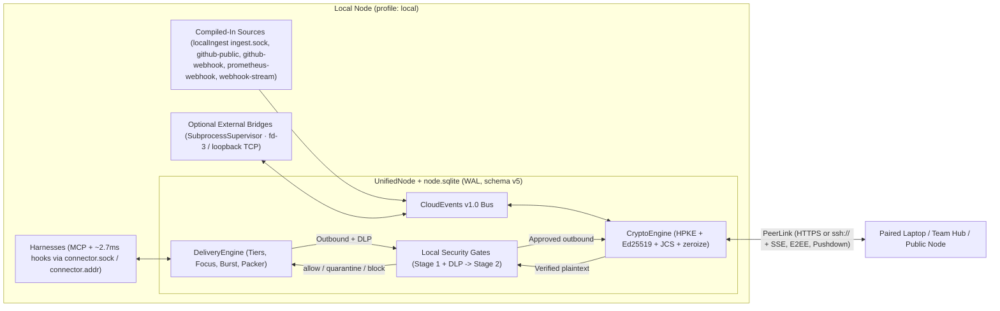

# Architecture Overview

Hyphae (`hyp`) is built around **one composable `Node` primitive** shipped as a single self-contained Rust binary (~8 MiB compressed download; static musl on Linux x86_64, native glibc on Linux arm64, zero Node.js or Python runtime required for core `hyp`).

---

## 1. Unified `Node` Data Flow

---

## 2. Core Layers

1. **Cryptographic Identity (`crates/hyp-crypto`):** Persistent Ed25519 signing + RFC 7748 X25519 encryption keypairs in `SecretStore` (macOS Keychain, Linux Secret Service, or `0600` file fallback), published as RFC 7517/8037 OKP JWKs with RFC 7638 `kid` thumbprints and deterministic `Zeroizing` memory wipes.
2. **Unified SQLite WAL Store (`crates/hyp-store`, schema v5):** Single `node.sqlite` (`rusqlite` bundled, WAL mode, atomic `BEGIN IMMEDIATE` migrations, exact `next_deadline_ms()` deadline scheduler):
   - **Bus:** `handles`, `events`, `subscriptions`, `batches`, `batch_events`, `upstream_pushdowns`, `channel_members`, `channel_epochs`, `transfers`
   - **Shared KV:** `kv_entries`, `kv_epochs` (owner/shared CAS/allowlist write models + optional `kv.e2ee.v1`)
   - **Federation:** `peers`, `grants`, `revocations`, `peer_keys`, `directory_checkpoints` *(schema reserved for planned signed checkpoints)*
   - **Local Runtime & Security:** `metadata`, `sessions`, `mailbox`, `muted_sources`, `plugin_targets`, `bridge_links`, immutable `gate_audit` (SQLite triggers)
   - **Human Authority:** `human_authorities` (with schema v5 `enc_jwk_json`), `human_nonces`, `human_node_certs`
3. **Composable Adapters (`NodeAdapter` in `crates/hyp-node` & `crates/hyp-harness`):**
   - **Harnesses & LocalDaemon:** Private `0600` Unix socket (`connector.sock`) or Windows loopback TCP + bearer token (`connector.addr`), `CallRegistry` + per-session HMAC `sessionToken`, zero-Tokio ~2.7 ms `hyp hook` fast path, ~2.8 MB RSS stateless `hyp mcp` multiplexer, and live hot-reload IPC RPCs (`peers.reload`, `gate.reload`, `inbox.wake`).
   - **Compiled-in Event Sources & Local Ingest:** Pure-Rust `github-public`, `github-webhook`, `prometheus-webhook`, `webhook-stream`, and default socket-only `localIngest` (`ingest.sock` / `ingest.addr`).
   - **External Subprocess Bridges:** Cross-platform `SubprocessSupervisor` over duplex Unix fd 3 (macOS/Linux) or authenticated loopback TCP with per-spawn 256-bit CSPRNG token (Windows), speaking JSON-RPC 2.0 v2 only, with scrubbed env, `CrashLoopBackOff` circuit breaker, `0600` redacted logs, and local-only bridge topics by default.
   - **Symmetric `PeerLink`s:** Bidirectional `hyper 1` HTTPS (or optional zero-port `ssh://` via `hyp connect` -> `0600` `peer.sock`) + WHATWG SSE links with RFC 9457 Problem Details, ETag caching, and aggregated filter pushdown (sharding merged CloudEvents filter ASTs when exceeding 4 KiB / depth 8).
4. **Configuration Profiles:** `local` (workstation, no listener by default), `p2p` (workstation + peer listener), and `router` (Team Hub or Public Node).

---

## 3. Addressing & Forwarding

- **Wire / Storage:** Always structured fields (`{ origin_node, topic }`, `{ host_node, channel }`, `{ host_node, namespace, key }`).
- **UX Shorthand:** Longest-prefix match against known peer IDs (`public.hyphae.to.github` -> peer `public.hyphae.to`, topic `github`; `local.<topic>` -> local EventStore; `<handle>` -> `local/<handle>`).
- **Forwarding & Loop Prevention:** `forwarding.mode` defaults to `"deny"` (only `"deny"` or `"allowlist"` accepted). Transit/hubs enforce `forwarding` rules alongside explicit `forward:via` and `dm:receive` scopes, plus `hyphaeorigin`/`hyphaevia`/`hyphaehops` (hard cap `4`) and W3C `traceparent`.

---

## 4. Standards-First Wire Layer & Capabilities

| Primitive | Standard / RFC | Implementation |
| --- | --- | --- |
| Bus & Filters | CloudEvents v1.0 + W3C `traceparent` + CE Subscriptions API v1.0 | `crates/hyp-proto` |
| Public-Key E2EE | RFC 9180 HPKE Base Mode (`X25519` + `HKDF-SHA256` + `AES-256-GCM`) | `crates/hyp-crypto` |
| Signing & Keys | RFC 8785 JCS + RFC 8032 Ed25519 + RFC 7517/8037 OKP JWK + RFC 7638 | `crates/hyp-proto`, `crates/hyp-crypto` |
| File Drops | POSIX `tar` + `gzip` + OCI `sha256` + 64 KiB chunked AEAD | `crates/hyp-crypto/src/transfer.rs` |
| HTTP & Errors | RFC 9457 Problem Details + RFC 9110 (`ETag`/`If-Match`/`Retry-After`) + WHATWG SSE | `crates/hyp-node` (`hyper 1`) |
| Plugin IPC | JSON-RPC 2.0 over NDJSON (Unix fd 3 / Windows authenticated loopback TCP, v2 only) | `crates/hyp-proto/src/rpc.rs` |
| Permissions | RFC 6749-style scope tokens + Signed `GET /v1/manifest` | `crates/hyp-proto/src/{scopes,manifest}.rs` |

See [Scopes & Capabilities](../reference/scopes.md) for active vs. reserved/planned endpoints (`POST /v1/bridges/post`, `POST /v1/node/update`, `directory.checkpoint.v1`), [Delivery Engine](delivery.md) for packing and wakeup rules, and [Testing Strategy](testing.md) for verification.
