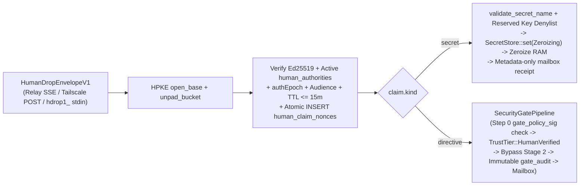

> **Historical RFC (2026) — Implemented & Archived.** **Superseded by the shipped implementation** documented in [Human Authority & Drop Relay](../security/human-authority.md) and [Phone Drops & `hyp exec`](../guides/phone-drops.md).

# RFC (MVP): Human Authority, Zero-Knowledge Cutout Drops & Self-Hostable Blind Relay

- **Status:** MVP Implementation Spec (streamlined from [RFC-human-authority-cutout-relay.md](RFC-human-authority-cutout-relay.md))
- **Target Runtime:** Hyphae v2 (`hyp`, Rust 1.87+ / `edition = "2024"`, **zero new Rust crypto dependencies**)
- **Footprint Goal:** ~2,300 LoC Rust across 6 crates + ~650 LoC static `site/drop/` shipped in **3 PRs**

---

## 1. MVP Problem & Core Idea

When a human talks to a mobile "comms agent" (Telegram / Slack / OpenClaw), Hyphae treats all mesh traffic as untrusted external data (`untrusted: true`) to stop prompt injection. That leaves two gaps:

1. **Authenticated directives:** Target agents (`prod@eu-1/ops`) cannot verify a directive really came from the human rather than a prompt-injected comms agent.
2. **Zero-knowledge secret passing ("Cutout"):** Passing an API key from a phone to a remote server must never put secret bytes into Telegram/Slack, the comms agent's LLM context, any relay disk/logs, or the target agent's LLM context.

**MVP Solution:** One cryptographic primitive (**Mode B: Audience-Bound Sign-then-Pad-then-HPKE Sealed Drop**, `hdrop1_`), one signature algorithm (**Ed25519 everywhere**), and one **RAM-only, self-hostable Blind Ephemeral Relay** (`256 MiB` default, `10m` TTL) backed by a minimal static mobile page (`site/drop/`).

---

## 2. Ruthless MVP Scope: In vs. Deferred

| Capability | **In MVP** | **Deferred Post-MVP** |
| --- | --- | --- |
| **Human Key Suite** | **Tier 1 ONLY (`Ed25519` everywhere):** Phone WebAuthn Passkey + `prf` -> HKDF-SHA256 -> `Ed25519`; Laptop CLI `Ed25519` in `SecretStore` (`hyp auth init` / `sign`) | WebAuthn `ES256` (P-256) fallback, Argon2id `hkey1_` wrapped key export, raw passphrase-derived keys |
| **Envelope Mode** | **Mode B ONLY (`human.drop.v1` / `hdrop1_`):** Direct E2EE HPKE sealed drop for `kind: "directive"` and `kind: "secret"` | Mode A detached `hauth1_` attestations (`human_pending_attestations` table), `kind: "approval"` remote quarantine release |
| **Mobile Input UX** | Human always **types or pastes fresh** on phone (zero `proposedText` pre-fill -> eliminates pre-fill smuggling) | Optional `proposedText` pre-fill |
| **Pubkey-Phishing Defense** | **Human-signed `NodeCertV1` (`hcert1_`)** in URL `#fragment` verified statelessly by phone Passkey + hard-block secrets on uncertified keys | Fleet directory sync / multi-human cert chains |
| **Secret Isolation** | Direct write into `SecretStore` / OS Keychain + reserved system-key denylist + metadata-only `to.hyphae.human.secret.stored.v1` receipt | `hyp exec --env VAR=<secret>` subprocess wrapper |
| **Gate Integration** | `TrustTier::HumanVerified` (bypasses Stage 2 LLM classifier), atomic single-use `claimId` nonce, `humanAuthoritiesDigest` in `gate_policy_sig`, immutable `gate_audit` | Multi-human `min_approvals` (2-of-3 quorum) |
| **Relay Auth & DoS** | **Authenticated `POST /v1/drops` ONLY** (`Hyphae-Ed25519` paired or `guest-ro` + `cutout:create`), stateless HMAC `postCap`/`subCap`, `256 MiB` RAM cap, `503` anti-eviction | Anonymous writes / Hashcash PoW |
| **Transports** | (1) Blind Ephemeral Relay (`public.hyphae.to` or 1-command self-hosted), (2) Direct Tailscale node (`POST /v1/drops/{id}` + PNA CORS), (3) Offline copy-paste `hdrop1_` | — |

---

## 3. Minimal Cryptographic Design (100% Existing `hyp-crypto` Primitives)

Because MVP uses **Ed25519 only**, `crates/hyp-crypto/src/keys.rs`, `hpke.rs`, `e2ee.rs`, `jcs.rs`, and `keystore.rs` require **zero breaking changes and zero new Cargo dependencies**.

### 3.1 Human Key Derivation (Phone Passkey + `prf` -> Ed25519)

1. **Phone (`site/drop/`):** WebAuthn Passkey with `extensions: { prf: {} }` and `userVerification: "required"` (stored in iCloud Keychain / Google Password Manager — **immune to Safari's 7-day ITP storage eviction** and natively origin-bound to `rpId`).
   ```text
   prf_input    = SHA-256("hyphae/v2/human-prf-input\n" || humanId || "\n" || prfSalt)
   ed25519_seed = HKDF-SHA256(
                    salt = "hyphae/v2/human-prf-ed25519",
                    ikm  = prf_results_first_32B,
                    info = humanId || "\n" || authEpoch_u64_be,
                    L    = 32
                  )
   ```
   The seed derives a standard `OKP/Ed25519` keypair in RAM, signs, and is immediately zeroed (`Uint8Array.fill(0)`).
2. **Laptop Admin/Recovery (`hyp auth init`):** Standard CSPRNG `Ed25519KeyPair::generate()` stored in `SecretStore` (`human-admin-<hash12>`). Separate `role = "admin"` (laptop: enrolls/revokes keys & signs `NodeCertV1`) from `role = "signer"` (phone: daily directives & secrets).

### 3.2 Domain Separation Constants

| Purpose | Domain String |
| --- | --- |
| Inner claim signature | `"hyphae/v2/human-claim\n"` |
| Node certificate signature | `"hyphae/v2/human-node-cert\n"` |
| Key revocation signature | `"hyphae/v2/human-revocation\n"` |
| HPKE `info` | `"hyphae/v2/human-drop\n1\n" \|\| recipientEncKid \|\| "\n" \|\| dropId` |
| HPKE `aad` | `"hyphae/v2/human-drop-aad\nhuman.drop.v1\n" \|\| recipientEncKid \|\| "\n" \|\| dropId` |
| Relay capability MAC | `"hyphae/v2/human-drop-cap\n"` |

### 3.3 Canonical Wire Envelopes (RFC 8785 JCS)

**Inner Signed Claim (`HumanClaimV1` -> `SignedPayload` under `"hyphae/v2/human-claim\n"`):**

```json
{
  "v": 1,
  "kind": "secret",
  "claimId": "<22-char base64url 128-bit single-use nonce>",
  "humanId": "bogdan",
  "humanKid": "<RFC 7638 Ed25519 JWK thumbprint>",
  "authEpoch": 1,
  "issuedAt": "2026-11-24T21:00:00Z",
  "expiresAt": "2026-11-24T21:10:00Z",
  "dropId": "<22-char base64url rendezvous id or empty for offline>",
  "audience": {
    "nodeId": "prod@eu-1",
    "nodeEncKid": "<target X25519 RFC 7638 thumbprint>",
    "handle": "ops"
  },
  "secretSpec": { "name": "stripe-prod-key", "overwrite": false },
  "body": "<plaintext directive or secret value>"
}
```

**Outer Sealed Envelope (`HumanDropEnvelopeV1`, armored as `hdrop1_<base64url(JCS)>`):**

1. Sign `JCS(HumanClaimV1)` with human Ed25519 key -> `SignedPayload { payload, sig }`.
2. Pad `JCS(SignedPayload)` via `hyp_crypto::e2ee::pad_bucket` (`256 B .. 32 KiB` power-of-2 bucket).
3. Seal via `hyp_crypto::hpke::seal_base` (`DHKEM(X25519, HKDF-SHA256)` + `HKDF-SHA256` + `AES-256-GCM`) to target node's X25519 public key.
4. Emit opaque wire JSON (**zero `humanKid`, zero `nodeId`, zero `recipientKid`, zero `kind`** visible to relay!):
   ```json
   { "v": 1, "suite": "human.drop.v1", "dropId": "...", "enc": "<43-char X25519>", "ct": "<base64url>" }
   ```

**Human-Signed Node Certificate (`NodeCertV1`, armored as `hcert1_<base64url(JCS)>`):**

```json
{
  "payload": "{\"authEpoch\":1,\"encryptionJwk\":{\"crv\":\"X25519\",\"kty\":\"OKP\",\"x\":\"...\"},\"expiresAt\":\"2027-11-24T00:00:00Z\",\"humanId\":\"bogdan\",\"humanKid\":\"...\",\"issuedAt\":\"2026-11-24T21:00:00Z\",\"nodeId\":\"prod@eu-1\",\"signingJwk\":{\"crv\":\"Ed25519\",\"kty\":\"OKP\",\"x\":\"...\"},\"v\":1}",
  "sig": "<Ed25519 sig under hyphae/v2/human-node-cert\n>"
}
```

**URL `#fragment` Format (`https://hyphae.to/drop#<base64url(JCS)>` — NO `proposedText`!):**

```json
{
  "v": 1,
  "dropId": "...",
  "relay": "https://public.hyphae.to",
  "postCap": "hdcap1_...",
  "nodeId": "prod@eu-1",
  "handle": "ops",
  "encJwk": { "kty": "OKP", "crv": "X25519", "x": "..." },
  "nodeCert": "hcert1_...",
  "kind": "secret",
  "secretName": "stripe-prod-key",
  "expiresAt": "2026-11-24T21:10:00Z"
}
```

> **Fail-Closed Browser Checks:** On load, `site/drop/` parses `window.location.hash` into RAM and immediately calls `history.replaceState(null, "", window.location.pathname)`. After Passkey+PRF unlocks `pk_human` (or using embedded `adminPubJwk` pinned during enrollment), it verifies `nodeCert` against `encJwk` & `nodeId`. **Uncertified keys are hard-blocked for `kind = "secret"`** (defeating comms-agent pubkey-substitution phishing). Human types or pastes fresh; zero pre-fill exists.

---

## 4. Target Node Verification, Secret Sink & Gate Integration



**Hard Fail-Closed Invariants on Target `UnifiedNode`:**
- **Policy Anti-Tamper:** `humanAuthoritiesDigest` (SHA-256 of canonical sorted `human_authorities` + `min_auth_epoch`) is signed inside `gate_policy_sig` (`crates/hyp-node/src/gates/policy.rs`). If `require_signed_policy == true` and `node.sqlite` or `node.json` was tampered with, ALL human claims fail closed (`gate_policy_tampered`).
- **Reserved System-Secret Denylist:** Reject `kind == "secret"` targeting `node-sign-*`, `node-enc-*`, `id-sign-*`, `id-enc-*`, `admin-ca-*`, `gate-policy-*`, `human-admin-*`, `human-authority-*`, `auth-token-*` (`reserved_secret_name`).
- **Zero-Leak Secret Sink:** Decrypt into `Zeroizing<String>`, call `SecretStore::set`, drop buffers immediately, write `gate_audit` with redacted metadata digest only, and emit `to.hyphae.human.secret.stored.v1 { secretName, backend, overwritten, humanAuthority }` (zero secret bytes in mailbox, logs, or LLM context!).
- **Single-Use Anti-Replay:** Atomic `INSERT INTO human_claim_nonces` inside `BEGIN IMMEDIATE` before executing either sink; expired nonces pruned automatically by `NodeDb::tick()`.

---

## 5. Blind Ephemeral Relay (`256 MiB` RAM) & 60-Second Self-Hosting

Implemented as an opt-in RAM-only module (`crates/hyp-node/src/engine/cutout_relay.rs`, `enabled: false` by default -> `404`).

### 5.1 Wire API & Bounded RAM Quotas

| Endpoint | Auth | Behavior |
| --- | --- | --- |
| `POST /v1/drops` | **`Hyphae-Ed25519` ONLY** (`cutout:create` scope; zero anonymous writes / zero PoW!) | Allocates 128-bit `dropId`, returns `{ dropId, expiresAt, postCap, subCap }` (stateless HMAC-SHA256 keyed by hourly-rotated in-RAM secret). |
| `POST /v1/drops/{id}` | `X-Hyphae-Drop-Cap: <postCap>` (constant-time check before reading body) | Appends opaque ciphertext (`<= 64 KiB`) to RAM FIFO (`Zeroizing<Vec<u8>>`), wakes SSE subscribers, returns `201 { seq, expiresAt }`. |
| `GET /v1/drops/{id}/stream` | `X-Hyphae-Drop-Cap: <subCap>` (or `Hyphae-Ed25519` creator) | WHATWG SSE with **late-subscriber catch-up**: immediately replays buffered items (`seq > Last-Event-ID`), then streams live arrivals until TTL or burn. |
| `POST /v1/drops/{id}/ack` | `X-Hyphae-Drop-Cap: <subCap>` (or `Hyphae-Ed25519` creator) | `{ seq, burn: true }` immediately **zeroizes and deletes** the buffered item/slot from RAM after target node persists it. |

**Default Configurable Bounds (`node.json` -> `cutoutRelay`):**

| Knobs | Default | Hard Ceiling / Notes |
| --- | --- | --- |
| `maxMemoryMb` | **`256` MiB** | Operator-configurable RAM ceiling; zero disk / SQLite writes |
| `defaultTtlSeconds` | **`600` s (10 min)** | Hard cap `900` s (15 min) |
| `maxItemsPerDrop` | **`16`** | Up to `1 MiB` buffered per drop |
| `maxPayloadBytes` | **`65,536` B (64 KiB)** | Checked via `Content-Length` + streaming `Limited` reader |
| `maxActiveDrops` | **`4,096`** | Per-guest: `3` active drops, `10` creates/hr; per-IP: `20` creates/hr |
| `maxSseStreams` | **`4,096`** | Max `2` per `dropId`, `16` per IP, 25s keepalive, 5s write timeout |
| **At Global Cap** | **`503 Service Unavailable`** | Sweeps expired slots first; **never** evicts honest in-flight drops (no noisy-neighbor LRU!) |
| **CORS / PNA** | Strict origin allowlist | `Access-Control-Allow-Origin: https://hyphae.to` (+ configured self-hosted origins) + `Access-Control-Allow-Private-Network: true` for Tailscale direct drops |

### 5.2 Dead-Simple 60-Second Self-Hosting

Anybody can run their own private or community blind relay using the **same static `hyp` binary**:

```sh
# 1. Generate turnkey standalone relay kit (node.json + Caddyfile + Docker Compose + Fly.io + systemd)
hyp deploy init cutout-relay \
  --domain drop.example.com \
  --max-memory-mb 256 \
  --out ./deploy-cutout

# 2. Launch via Docker Compose, systemd + Caddy, or Fly.io (Caddy suppresses /v1/drops/* logs!)
docker compose -f ./deploy-cutout/docker-compose.yml up -d
# — OR run directly on any existing host / Team Hub / Tailscale node:
hyp node start --profile router --enable-cutout-relay --cutout-max-memory-mb 256

# 3. Point any fleet node at your relay (stored in node.json -> cutoutRelay.url; default: https://public.hyphae.to)
hyp relay set https://drop.example.com
```

`hyp deploy init public-node --enable-cutout-relay` also enables the exact same module alongside `github-public` on `public.hyphae.to` (with aggregate-only counters in `GET /v1/health`: `activeDrops`, `bufferedBytes`, `dropsCreatedTotal`, `dropsDeliveredTotal`).

---

## 6. Minimal SQLite Migration (`0003_human_authority.sql`)

Schema bumps cleanly from `2 -> 3` (only **3 compact tables + 1 column**, no Mode A table, no ES256 columns):

```sql
CREATE TABLE IF NOT EXISTS human_authorities (
    human_id TEXT NOT NULL,
    kid TEXT NOT NULL,
    label TEXT NOT NULL,
    role TEXT NOT NULL CHECK (role IN ('admin', 'signer')),
    jwk_json TEXT NOT NULL,        -- OKP/Ed25519 JWK only
    prf_salt TEXT,                 -- 128-bit base64url salt for Passkey+PRF phone keys
    auth_epoch INTEGER NOT NULL DEFAULT 1,
    status TEXT NOT NULL DEFAULT 'active' CHECK (status IN ('active', 'revoked')),
    created_at INTEGER NOT NULL,
    revoked_at INTEGER,
    revocation_json TEXT,
    PRIMARY KEY (human_id, kid)
);
CREATE INDEX IF NOT EXISTS human_authorities_kid ON human_authorities (kid, status);

CREATE TABLE IF NOT EXISTS human_claim_nonces (
    claim_id TEXT PRIMARY KEY,
    human_kid TEXT NOT NULL,
    kind TEXT NOT NULL CHECK (kind IN ('directive', 'secret')),
    expires_at INTEGER NOT NULL,
    consumed_at INTEGER NOT NULL
);
CREATE INDEX IF NOT EXISTS human_claim_nonces_expires ON human_claim_nonces (expires_at);

CREATE TABLE IF NOT EXISTS human_node_certs (
    node_id TEXT NOT NULL,
    human_kid TEXT NOT NULL,
    auth_epoch INTEGER NOT NULL,
    signed_json TEXT NOT NULL,
    issued_at INTEGER NOT NULL,
    expires_at INTEGER NOT NULL,
    PRIMARY KEY (node_id, human_kid)
);

ALTER TABLE mailbox ADD COLUMN human_auth_json TEXT;
```

---

## 7. Concrete MVP Build Blueprint (File-by-File, Est. LoC & 3-PR Plan)

### 7.1 File-by-File Change Map

| Crate / Dir | Files to Add / Edit | Responsibility | Est. LoC |
| --- | --- | --- | --- |
| **`hyp-proto`** | `cloudevent.rs`, `manifest.rs`, `scopes.rs` | `TYPE_HUMAN_DROP_V1`, `TYPE_HUMAN_SECRET_STORED_V1`, `TYPE_HUMAN_REVOCATION_V1`; `CapabilityToken::{HumanAuthV1, CutoutRelayV1}`; `ParsedScopeV2::CutoutCreate`; `TrustTier::HumanVerified` | ~120 |
| **`hyp-crypto`** | `src/human.rs` *(new)*, `src/lib.rs`, `tests/golden_human_mvp.rs` *(new)* | `HumanClaimV1`, `HumanDropEnvelopeV1` (`seal_human_drop` / `open_human_drop`), `NodeCertV1`, `HumanRevocationV1`, `hdrop1_`/`hcert1_`, reserved secret-name guard, golden + mutated vectors | ~480 |
| **`hyp-store`** | `migrations/0003_human_authority.sql` *(new)*, `src/human.rs` *(new)*, `src/db.rs`, `src/local.rs`, `src/scheduler.rs` | Migration `2 -> 3`, `HumanAuthorityStore`, atomic `consume_claim_nonce`, `mailbox.human_auth_json`, nonce pruning in `NodeDb::tick()` | ~320 |
| **`hyp-node`** | `gates/{policy,stage1,pipeline}.rs`, `engine/cutout_relay.rs` *(new)*, `engine/{config,node,server}.rs` | `TrustTier::HumanVerified`, `humanAuthoritiesDigest` in `gate_policy_sig`, `ingest_human_drop` (`SecretStore` sink + mailbox delivery), RAM-only `CutoutRelay` (`256 MiB`, SSE catch-up, burn-after-read, PNA CORS) | ~780 |
| **`hyp-harness`** | `src/mcp.rs`, `src/daemon.rs` | `hyp_mesh({ action: "drop_link", kind, secretName?, ttlSeconds? })` + transparent `hdrop1_` forwarding in `hyp_send` (keeps 4-tool core catalog!) | ~140 |
| **`hyp-cli`** | `src/auth_cmd.rs` *(new)*, `src/drop_cmd.rs` *(new)*, `src/deploy.rs`, `src/main.rs` | `hyp auth init\|add\|list\|revoke\|certify-node\|sign`; `hyp drop create\|wait\|ingest`; `hyp relay set <url>`; `hyp deploy init cutout-relay` (Caddy/Docker/Fly/systemd) | ~520 |
| **`site/drop/`** | `index.html`, `drop.js`, `crypto.js`, `styles.css` *(new static bundle)* | Zero-CDN strict-CSP mobile UI: `#fragment` parse + scrub, Passkey+`prf` -> HKDF -> Ed25519, `NodeCertV1` verify, fresh type/paste UI, RFC 8785 JCS + bucket pad + RFC 9180 HPKE seal, relay `POST` + offline `hdrop1_` copy fallback | ~650 |
| **Total** | — | **~2,360 LoC Rust + ~650 LoC static browser JS/HTML/CSS** | **~3,010** |

### 7.2 Minimal 3-PR Build Sequence

- **PR 1 — Core Crypto, Store, Gate Integration & Offline `hdrop1_` (`hyp-proto`, `hyp-crypto`, `hyp-store`, `hyp-node/gates`, `hyp-cli`):**
  - Ships end-to-end human key init, `NodeCertV1`, `hdrop1_` sealing/opening, `SecretStore` zero-knowledge sink, `TrustTier::HumanVerified` + `gate_policy_sig` binding, and `hyp auth` + `hyp drop ingest` CLI. **Immediately usable offline/copy-paste with zero relay or web UI!**
- **PR 2 — RAM-Only `CutoutRelay`, Self-Host Kit & Agent Drop Links (`hyp-node/engine`, `hyp-harness`, `hyp-cli`):**
  - Ships `CutoutRelay` (`256 MiB` default, `Hyphae-Ed25519` gated `POST /v1/drops`, HMAC `postCap`/`subCap`, late-subscriber SSE catch-up, `burn: true` zeroization, Tailscale PNA CORS), `hyp deploy init cutout-relay`, `hyp relay set`, `hyp drop create|wait`, and `hyp_mesh({ action: "drop_link" })`.
- **PR 3 — Mobile Passkey+PRF Drop Page & Cross-Language CI Interop (`site/drop/`):**
  - Ships minimal static `https://hyphae.to/drop` page (strict CSP, zero CDN, Passkey+PRF -> Ed25519, `NodeCertV1` check, fresh input, relay POST + offline `hdrop1_` fallback) plus headless browser CI verifying bit-exact `site/drop/` <-> `hyp-crypto` golden vectors.

### 7.3 MVP Verification Criteria (Before Marking Done)

1. **Standard workspace checks pass cleanly:**
   ```sh
   cargo clippy --workspace --all-targets -- -D warnings
   HYPHAE_SECRET_BACKEND=file cargo test --workspace
   cargo build --release -p hyp-cli
   ```
2. **Cross-language golden parity (McKeeman oracle):** `site/drop/` JS/WASM seals a `directive` and `secret` against frozen test keys -> Rust `hyp-crypto::human::open_human_drop` decrypts & verifies cleanly (and reverse).
3. **Mutated-input fail-closed suite:** 1-bit flip in `enc`/`ct`/AEAD tag/`sig`/`nodeCert`/`postCap`, replayed `claimId` (16-thread race -> exactly 1 succeeds), expired `expiresAt`, wrong `nodeId`/`handle`, rolled-back `authEpoch`, revoked `humanKid`, reserved `secretName` (`node-sign-*`, `gate-policy-hmac-key`), and tampered `human_authorities` under `require_signed_policy = true` all fail closed.
4. **Late-subscriber & burn-after-read relay test:** Submit `POST /v1/drops/{id}` -> wait -> connect `GET /v1/drops/{id}/stream` -> verify catch-up delivery -> `POST /ack { burn: true }` -> reconnect -> verify 0 items & `bufferedBytes == 0`.
5. **Anti-DoS & self-host smoke test:** Unauthenticated `POST /v1/drops` returns `401`; filling `maxMemoryMb` returns `503` without evicting honest in-flight drops; `hyp deploy init cutout-relay && hyp deploy check` exits `0` with zero plaintext secrets.
